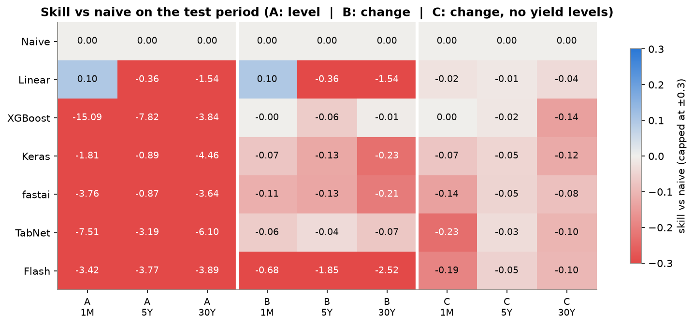
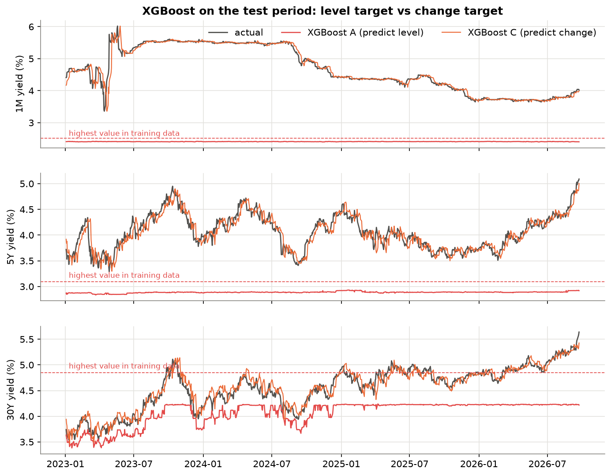

# Yield Curve Prediction with Supervised Learning

Predicting the **1-month, 5-year and 30-year US Treasury yields 5 trading days (one week) ahead**, and comparing five frameworks: **XGBoost, Keras, PyTorch + fastai, PyTorch + TabNet and PyTorch + Lightning Flash**. A naive "no change" forecast and linear regression are used as baselines.

Data: daily, January 2010 to September 2026, from **Yahoo Finance** (`yfinance`) and **FRED**.

## Authors

MLBD project, Department of AIML, PES University

| Name | SRN |
|---|---|
| Ashwin Anand | PES1UG24AM057 |
| Abhishek Mundanat | PES1UG24AM012 |

## Main results

The test period runs from January 2023 to September 2026. Neural networks are averaged over 3 random seeds.

| Experiment | What is predicted | Inputs |
|---|---|---|
| A | yield level 5 days ahead (as in the original case study) | all 23 features |
| B | 5-day change of the yield | all 23 features |
| C | 5-day change of the yield | 15 features (no raw yield levels) |

Average test RMSE over 1M, 5Y and 30Y, in basis points:

| Model | A | B | C | Skill vs naive (C) |
|---|---|---|---|---|
| Naive (no change) | 13.2 | 13.2 | **13.2** | 0 |
| Linear regression | 20.1 | 20.1 | 13.5 | -0.024 |
| XGBoost | 137.2 | 13.5 | 13.8 | -0.052 |
| Keras | 42.6 | 15.0 | 14.2 | -0.081 |
| fastai | 49.1 | 15.1 | 14.4 | -0.090 |
| TabNet | 87.2 | 13.9 | 14.9 | -0.123 |
| Lightning Flash | 61.7 | 34.3 | 14.7 | -0.114 |

- **Predicting the level fails.** The test period has yields higher than anything in the training data (2010-2021), and tree models can't predict outside the range they were trained on.
- **Predicting the change works much better**, but **no model beats the naive forecast**. A Diebold-Mariano test finds no model significantly better than naive (0 of 18 model-target pairs), and 8 of 18 significantly worse.
- **Framework scores** (1-5 for simplicity, transparency and efficacy, then averaged): XGBoost 4.7, TabNet 2.8, Keras 2.5, fastai 2.1, Lightning Flash 1.8.




The full write-up is in `report/report.pdf`, and the slides are in `presentation/yield_curve_prediction.pptx`.

## Project structure

```
src/
  config.py          dates, tickers, split, experiments, seeds
  data.py            download from FRED and Yahoo, build the daily dataset
  features.py        feature engineering, targets, time-based split, scaling
  evaluate.py        metrics, saving predictions, permutation importance
  plots.py           plot style and colours
notebooks/
  01_data_collection.ipynb
  02_eda.ipynb
  03_baselines.ipynb        naive + linear regression
  04_xgboost.ipynb
  05_keras.ipynb
  06_fastai.ipynb
  07_tabnet.ipynb
  08_lightning_flash.ipynb  runs in the separate flash-env kernel
  09_comparison.ipynb       reads the saved predictions and compares everything
data/raw/            downloaded series (frozen at 30 Sep 2026)
data/processed/      final daily dataset
results/             predictions, metrics, feature importances, figures
scripts/             environment checks
report/              project report (docx + pdf)
presentation/        slides
```

## Setup

Two environments are needed. Lightning Flash 0.8.2 (archived in 2023) requires `pytorch-lightning<2.0`, so it can't be installed together with the newer PyTorch used by fastai.

Main environment (Python 3.12):

```bash
python3.12 -m venv .venv
.venv/bin/pip install -r requirements.txt
.venv/bin/python -m ipykernel install --user --name yield-main
.venv/bin/python scripts/check_setup.py
```

Lightning Flash environment (Python 3.10):

```bash
python3.10 -m venv .venv-flash
.venv-flash/bin/pip install -r requirements-flash.txt
.venv-flash/bin/python -m ipykernel install --user --name flash-env
.venv-flash/bin/python scripts/check_flash.py
```

## How to run

Run the notebooks in order, 01 to 09. Each notebook only needs the files written by the notebooks before it. Notebook 01 downloads the data again. The raw CSVs are already in `data/raw/`, so from notebook 02 onwards everything can be reproduced offline.

## Notes and problems found

- **FRED download:** `pd.read_csv(url)` fails with an SSL certificate error on the python.org build of Python for macOS, so the data is downloaded with `requests`.
- **XGBoost and PyTorch in one process** (macOS): both ship their own OpenMP library, and PyTorch hangs. Every framework therefore has its own notebook, and notebook 09 only reads CSV files.
- **Lightning Flash** needs `setuptools<81` (pytorch-lightning 1.9 imports `pkg_resources`) and `requests`, which Flash uses but doesn't declare.
- **Lightning Flash normalises the DataFrames you pass it in place.** Reusing a DataFrame gives wrongly scaled data. Always pass `df.copy()`.
- For linear regression, experiments A and B give identical results. This is expected: today's yields are inputs, so both targets are the same least-squares problem.

## References

- Tatsat, Puri & Lookabaugh (2020), *Machine Learning and Data Science Blueprints for Finance*, O'Reilly (the original case study)
- Chen & Guestrin (2016), XGBoost; Arik & Pfister (2021), TabNet; Howard & Gugger (2020), fastai
- Diebold & Li (2006); Diebold & Mariano (1995); Litterman & Scheinkman (1991)
